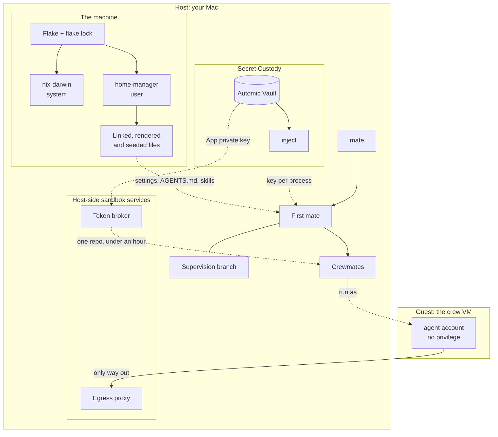
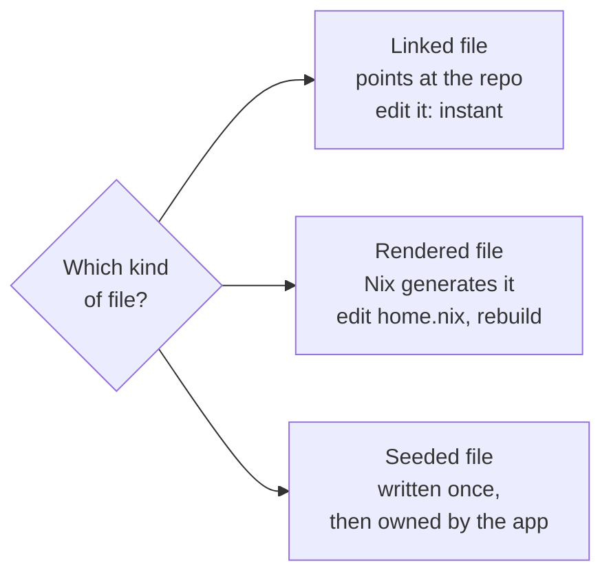
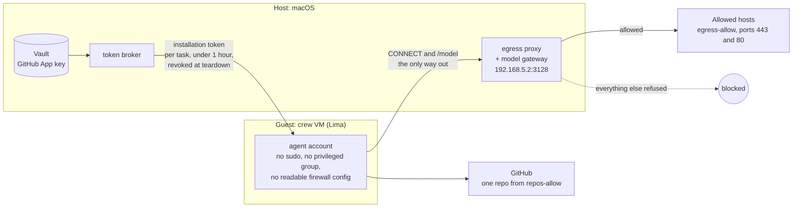

# Glossary

The words [agentic-dev-env](README.md) uses in its own, narrow sense. If a term in the README, an ADR or a config file is unfamiliar, look it up here.

## How to use this page

- **First time through?** Read [The concept map](#the-concept-map), then the sections in order. They follow the README: the machine, config delivery, secrets, the agent crew and its sandbox, and the checks.
- **Looking for one term?** Use the [A to Z index](#a-to-z-index).
- **Hit a command you do not recognise?** See [Commands at a glance](#commands-at-a-glance).

## The concept map

The repo builds a Mac, runs a crew of agents on it, and keeps secrets and network access under tight control.

## A to Z index

[agent account](#agent-account) · [agentic-dev-env link](#agentic-dev-env-link) · [Activation](#activation) · [ADR](#adr) · [Additive](#additive-homebrew) · [AGENTS.md](#agentsmd) · [Approval](#approval) · [Automic Vault](#automic-vault) · [av](#av) · [Captain](#captain) · [Cask](#homebrew-brew-cask) · [check](#check) · [Companion CLIs](#companion-clis) · [crew-dispatch.json](#crew-dispatchjson) · [crew VM](#crew-vm) · [Crewmate](#crewmate) · [Declarative](#declarative) · [egress proxy](#egress-proxy) · [Effort](#effort-thinking-level) · [First mate](#first-mate) · [Firstmate](#firstmate) · [Flake](#flake) · [guest](#guest) · [hardening](#hardening) · [harness](#harness) · [herdr](#herdr) · [home-manager](#home-manager) · [host](#host) · [identity](#identity) · [Impure evaluation](#impure-evaluation) · [inject](#inject) · [isotope](#isotope) · [Lima](#lima) · [mate](#mate) · [model gateway](#model-gateway) · [nix-darwin](#nix-darwin) · [Nix store](#nix-store) · [pi](#pi) · [pi wrapper](#pi-wrapper) · [principle skill](#principle-skill) · [Rebuild](#rebuild) · [rendered file](#rendered-file) · [scan finding](#scan-finding) · [Secret Custody](#secret-custody) · [seeded file](#seeded-file) · [Skill](#skill) · [supervision branch](#supervision-branch) · [tap](#tap) · [token broker](#token-broker) · [Worktree](#worktree)

---

## 1. The machine

How the Mac itself is defined and built.

### declarative

You describe _what_ the machine should look like (these packages, these settings, these apps) rather than listing the steps to get there. The tooling works out the steps, and re-running it converges on the same result.

### flake

A Nix project with a standard entry file, `flake.nix`, that lists its **inputs** (nixpkgs, nix-darwin, home-manager, nix-homebrew, the Automic Vault tap, pi) and what it produces. Here it produces the macOS system configuration. `flake.lock` pins every input to an exact version, so updating one is a deliberate act (for example `nix flake update pi`, then `./rebuild.sh`).

### nix-darwin

Declares the **system layer** of macOS: defaults, fonts, the Tailscale daemon and Homebrew. Lives in `configuration.nix` and `tailscale.nix`.

### home-manager

Declares the **user layer**: packages, zsh, starship, git config and the links that put files into `$HOME`. Lives in `home.nix`. It runs _last_ during a rebuild.

### Nix store

The read-only directory where Nix keeps everything it builds. A program that must rewrite its own config cannot write through a link into it, which is why a [seeded file](#seeded-file) exists.

### impure evaluation

Nix normally evaluates a flake without looking at your environment. This repo evaluates **impurely** (`nix build --impure`) so that [identity](#identity) can be read from environment variables. The result is that the configuration belongs to whoever runs the script.

### identity

The triple of username, home directory and host the configuration is built for. `identity.nix` reads it from the environment at evaluation time, so the same clone configures whoever runs `./rebuild.sh`.

### host

Two meanings, depending on context:

- **The configuration name.** The `darwinConfigurations` attribute the flake builds, taken from `AGENTIC_DEV_ENV_HOST`. It is not necessarily the machine hostname; it only names the configuration in this repo.
- **The macOS machine.** The side that runs the crew VM, as opposed to the [guest](#guest).

### rebuild

Running `./rebuild.sh`: build as you, activate as root. It is the only entry point, for a fresh machine and for re-applying changes, and it is idempotent (safe to run repeatedly).

### activation

The final rebuild step, run as root, that switches the machine to the newly built configuration. It is why you see one `sudo` prompt. See [ADR-0004](docs/adr/0004-build-as-user-activate-as-root.md).

### agentic-dev-env link

The symlink `~/.agentic-dev-env` that points at the clone. Every config path in this repo resolves through it, so `home.nix` can name files without knowing where the clone lives.

### Homebrew, brew, cask

Homebrew handles **GUI apps** (a _cask_ is a packaged app such as VS Code or wezterm) and a few command-line tools (_brews_). Nix handles the rest.

### additive (Homebrew)

With `homebrew.onActivation.cleanup = "none"`, Homebrew only adds and upgrades; anything not listed is left alone. The catch: **deleting an entry does not uninstall it**, so run `brew uninstall --cask <name>` yourself. See [ADR-0006](docs/adr/0006-homebrew-is-additive.md).

### tap

A Homebrew repository of formulae and casks outside homebrew-cask, declared here as `automic-vault/isotopes`. Its content is pinned as a flake input and stays mutable on disk; see [ADR-0001](docs/adr/0001-homebrew-taps-stay-mutable.md).

### isotope

A signed Homebrew formula or cask shipped by a tap; the one used here is `automic-vault/isotopes`. Homebrew loads it only because the cask entry is fully qualified and `trusted`.

---

## 2. How config files are delivered

Every config file reaches `$HOME` one of three ways, and the way decides whether an edit needs a rebuild.

### linked file

A symlink from `$HOME` back into this repo. Edit the file in the repo and the change is live: **no rebuild**. Examples: wezterm, neovim, herdr, pi settings, `AGENTS.md`, skills, firstmate config.

### rendered file

A file whose content Nix generates, unlike a linked file that only points at the repo. Rendered files need `./rebuild.sh` after an edit. Example: `~/.config/git/config`, edited in `home.nix`.

### seeded file

A file Nix writes once into `$HOME` as a real, user-owned file and then leaves alone on later rebuilds, because the application itself writes it. VS Code's `settings.json` is the only one: its atomic saves cannot write through a link into the read-only store, so a rebuild seeds it only when it is missing or still the old store link. To restore defaults, delete it and run `./rebuild.sh`. See [ADR-0008](docs/adr/0008-vscode-owns-its-settings.md).

---

## 3. Secrets

### Secret Custody

The Automic Vault store that holds every secret this machine needs, behind its own approval. Tools read from it through [inject](#inject); the secret itself is never written to a dotfile.

### Automic Vault

The macOS menu bar app that fronts Secret Custody. It must be running for any `av` command that needs approval, otherwise you get `approval service is not running`.

### av

The Automic Vault command-line tool, installed by the app's **Install av CLI** button into a root-owned `/usr/local/bin/av`.

### inject

`av inject NAME -- command` runs a command with one vault secret in its environment for the life of that process. It is how secrets reach tools here: nothing becomes ambient in the shell.

### approval

The prompt Automic Vault shows when something asks for a secret. Granting **Allow Launcher** to WezTerm for `DEEPSEEK_API_KEY` stops it asking on every `mate` launch.

### hardening

`av harden`: replacing a tool's own credential handling with a launcher that asks the vault for approval. A hardened tool keeps no usable secret of its own. Check with `av doctor gh`.

### scan finding

A result reported by `av scan`, with a severity such as HIGH or medium. A finding is fixed, accepted with a reason, or left as a manual step. The current list is in the README's [security scan section](README.md#security-scan-findings).

---

## 4. The agent crew

### harness

The agent program that runs a model, such as pi. Here pi is the only one, for the first mate and for crewmates alike, so the model can change without the harness changing. See [ADR-0005](docs/adr/0005-pi-only-harness.md).

### pi

The harness. It comes from its own flake input, so its version moves only when `flake.lock` does. Update it with `nix flake update pi` then `./rebuild.sh`, never `pi update pi`.

### pi wrapper

`home/.local/bin/pi`, a thin script that shadows the real `pi`. A fresh crewmate pane has no `DEEPSEEK_API_KEY`, so the wrapper re-runs itself under `av inject`. If `av` fails the launch stops rather than running signed out. Probes that need no key (`--help`, `--version`, `--list-models`, `auth`, `update`) pass straight through.

### mate

The shell alias that starts the crew. It injects the key into the first mate only: roughly `av inject +DEEPSEEK_API_KEY -- env FM_BACKEND=herdr pi`.

### Firstmate

The open-source project ([kunchenguid/firstmate](https://github.com/kunchenguid/firstmate)) cloned by hand to `~/firstmate`. It updates itself (`/updatefirstmate`), so this repo never installs or updates it.

### first mate

The pi session started by `mate` inside `~/firstmate`. It is the only agent you talk to: it turns a request into parallel tasks and hands them to crewmates.

### crewmate

An agent a first mate spawns for one task, in its own herdr tab and git worktree. Here it is pi on DeepSeek V4.1 Flash, chosen by `home/firstmate/crew-dispatch.json`.

### captain

The human in the main conversation with the first mate. "Captain-worthy" means something that needs a human decision.

### supervision branch

Firstmate's second conversation, beside the captain's chat, that triages fleet wakes in a model and escalates only what the captain should see. This repo pins it to `deepseek/deepseek-flash` at `low` effort through `home/firstmate/supervision-branch-*`, while the captain's own conversation keeps `settings.json`'s model and effort.

### crew-dispatch.json

`home/firstmate/crew-dispatch.json`, linked to `~/firstmate/config/crew-dispatch.json`. It declares the harness and provider crewmates use and omits the model, so they inherit the default from `settings.json`.

### effort (thinking level)

How hard a model is asked to think before answering. The default is `high` (`defaultThinkingLevel`); the supervision branch is pinned to `low`.

### herdr

The terminal multiplexer that hosts the first mate and crewmates in tabs and panes, and provides the event stream the fleet watcher listens to. Installed by Homebrew.

### worktree

A git feature giving an extra working directory for the same repository. Each crewmate gets its own, so parallel tasks never collide.

### companion CLIs

Helper tools firstmate expects: `gh-axi`, `chrome-devtools-axi`, `tasks-axi`, `quota-axi`, `lavish-axi`, `treehouse`, `no-mistakes`. They are not in nixpkgs, so each is installed once by its own installer. `mate` reports any that are missing as `MISSING:`.

### AGENTS.md

The single copy of the global agent instructions, `home/AGENTS.md`, linked to `~/.pi/agent/AGENTS.md`. The `~/.claude/CLAUDE.md` and `~/.claude/AGENTS.md` links remain for any agent that still looks there.

### skill

A folder of instructions an agent can load for a kind of work. Everything under `home/.agents/skills` is linked into `~/.agents/skills` and `~/.claude/skills`, so adding one needs **no change to `home.nix`**.

### principle skill

One leaf skill under `home/.agents/skills/software-engineering-principles`, vendored from pstack (MIT, Lauren Tan) and linked into `~/.agents/skills`. It keeps `disable-model-invocation: true`, so it loads only on request; the local `engineering-principles` skill is the index that makes it apply, and `home/AGENTS.md` makes that index mandatory. See [ADR-0007](docs/adr/0007-engineering-principles-are-skills.md).

---

## 5. The crew sandbox

The sandbox is the isolation layer around the agents: one VM, one narrow way out to the network, and short-lived, single-repo GitHub credentials. It is driven by the `crew-sandbox` command.

### crew VM

The one [Lima](https://lima-vm.io) guest defined by [nix/crew-sandbox/lima.yaml](nix/crew-sandbox/lima.yaml), which the fleet will run inside. It is **replaced rather than patched**: changing its definition means destroying it and creating it again.

### guest

The Linux side of the crew VM, as opposed to the [host](#host). A guest property is one asserted from inside, over SSH, not read from the definition file.

### agent account

The `agent` Linux user inside the crew VM. Agents run as it, and it holds no privilege: no sudo, no privileged group, no readable firewall configuration. It is not an account you log in as; `crew-sandbox shell` gives you the administration account instead.

### egress proxy

`crew-sandbox proxy`, a CONNECT proxy on the host that the guest reaches at `192.168.5.2:3128`. It holds no credentials for the allowlist route and terminates no TLS; it allows the hosts in `egress-allow` on ports 443 and 80 and refuses everything else. It is the guest's only way out. The same listener also carries the [model gateway](#model-gateway), the one route that holds a credential.

### model gateway

The `/model` route on the [egress proxy](#egress-proxy). The guest's [pi](#pi) points its `deepseek` provider at `http://host.lima.internal:3128/model` through `guest/models.json`; the gateway checks the token in `/etc/crew-model-token`, replaces it with the real `DEEPSEEK_API_KEY` that only the proxy process holds, and forwards the request to `https://api.deepseek.com`. It is how the guest gets a model without ever holding the model key. `crew-sandbox check model` proves the route refuses an unauthenticated request and reaches the API with the host's key.

### token broker

`crew-sandbox broker`, a host-side service that mints one GitHub App installation token per task, for one repository listed in `repos-allow`, valid for under an hour and revoked at teardown. It holds the App private key from the vault; a crewmate never sees a GitHub credential of its own. `crew-sandbox check broker` proves the scope and the revoke against GitHub; `crew-sandbox kill` stops the VM and revokes every token the broker still holds. Binding a token to the task that asked waits for the spawn path in phase 4.

---

## 6. Quality and decisions

### check

The tracked `.githooks/check` module that formats and lints this repo. `--staged` is the default and what git runs through `.githooks/pre-commit`; `--all` checks every tracked file and also evaluates the flake.

| Tool                                   | Used on                             | Kind                                              |
| -------------------------------------- | ----------------------------------- | ------------------------------------------------- |
| nixfmt, shfmt, StyLua, Prettier, Taplo | Nix, shell, Lua, web and docs, TOML | Formatters                                        |
| statix, deadnix                        | Nix                                 | Linters (block the commit)                        |
| ShellCheck                             | Shell                               | Linter                                            |
| Selene                                 | Lua                                 | Linter (`.selene/vim.yml` defines Neovim globals) |
| swiftlint, swift-format                | Swift                               | Linters, run with `--strict`                      |

### ADR

Architecture Decision Record: a short note in `docs/adr/` explaining one decision that is not obvious from the code, and why it was made.

---

## Commands at a glance

| Command                              | What it does                                              |
| ------------------------------------ | --------------------------------------------------------- |
| `./rebuild.sh`                       | Build and apply the whole configuration                   |
| `mate`                               | Start the first mate and its crew                         |
| `crew-sandbox shell`                 | Open a shell in the crew VM as the administration account |
| `crew-sandbox proxy`                 | Run the egress proxy and model gateway on the host        |
| `crew-sandbox broker`                | Run the GitHub token broker on the host                   |
| `crew-sandbox check broker`          | Mint, scope and revoke a real token against GitHub        |
| `crew-sandbox kill`                  | Stop the VM and revoke every token the broker issued      |
| `nix flake update <input>`           | Move one pinned input forward, then rebuild               |
| `av save <NAME>`                     | Store a secret in Secret Custody                          |
| `av inject <NAME> -- <cmd>`          | Run a command with a secret for that process only         |
| `av harden gh` / `av doctor gh`      | Harden the GitHub CLI / check it is healthy               |
| `av scan`                            | Audit the machine for exposed secrets                     |
| `.githooks/check --staged` / `--all` | Format and lint changed files / everything                |
| `brew uninstall --cask <name>`       | Remove an app you deleted from the config                 |
