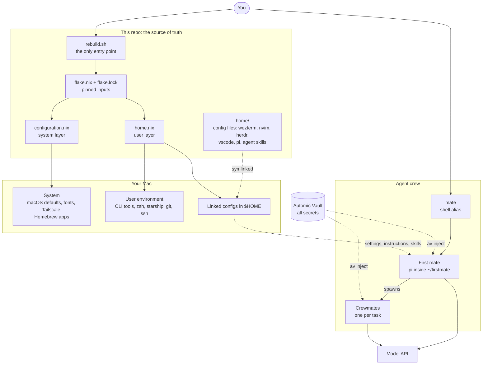
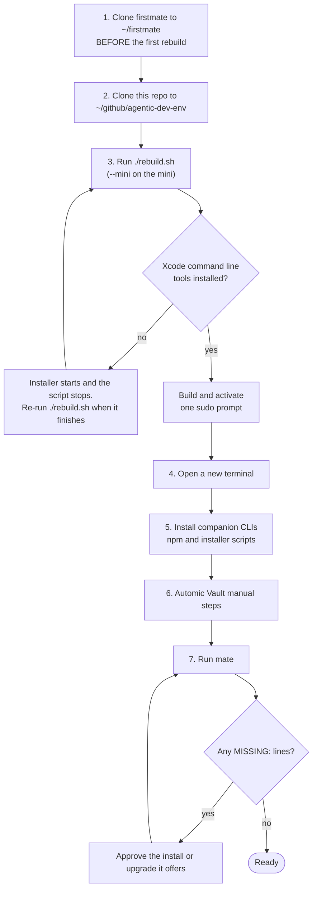
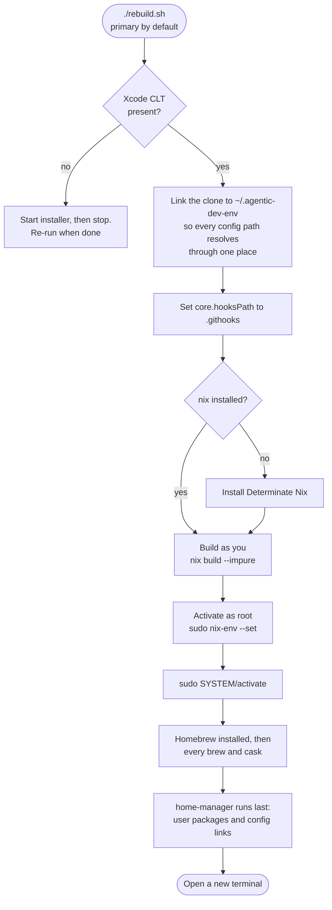
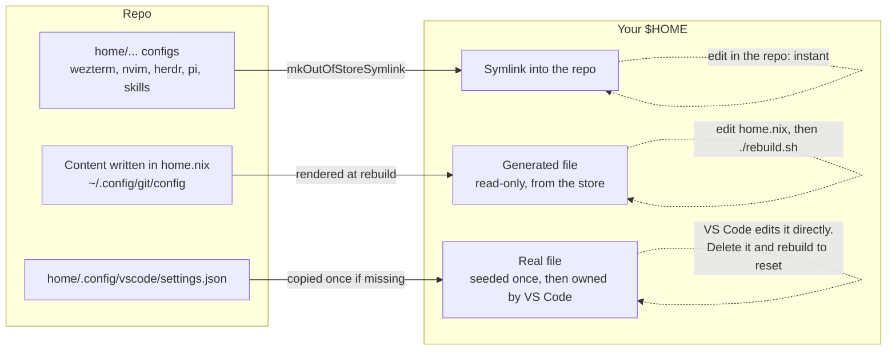
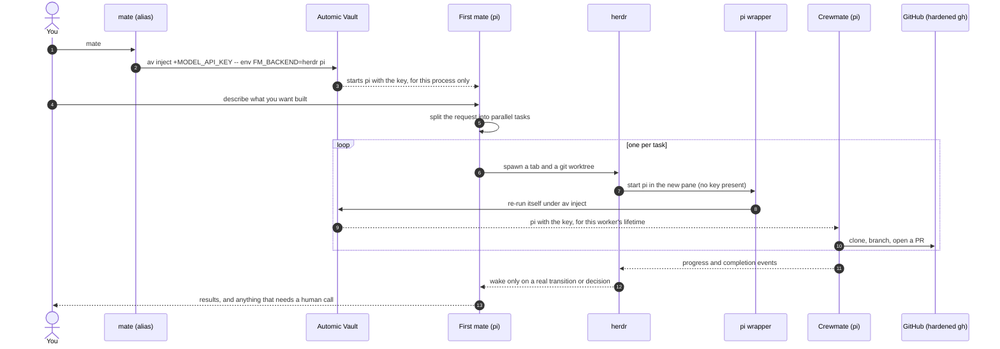
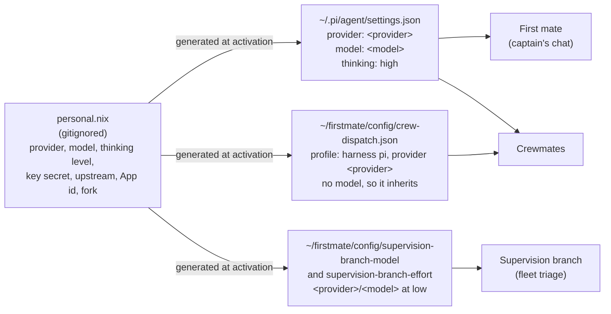
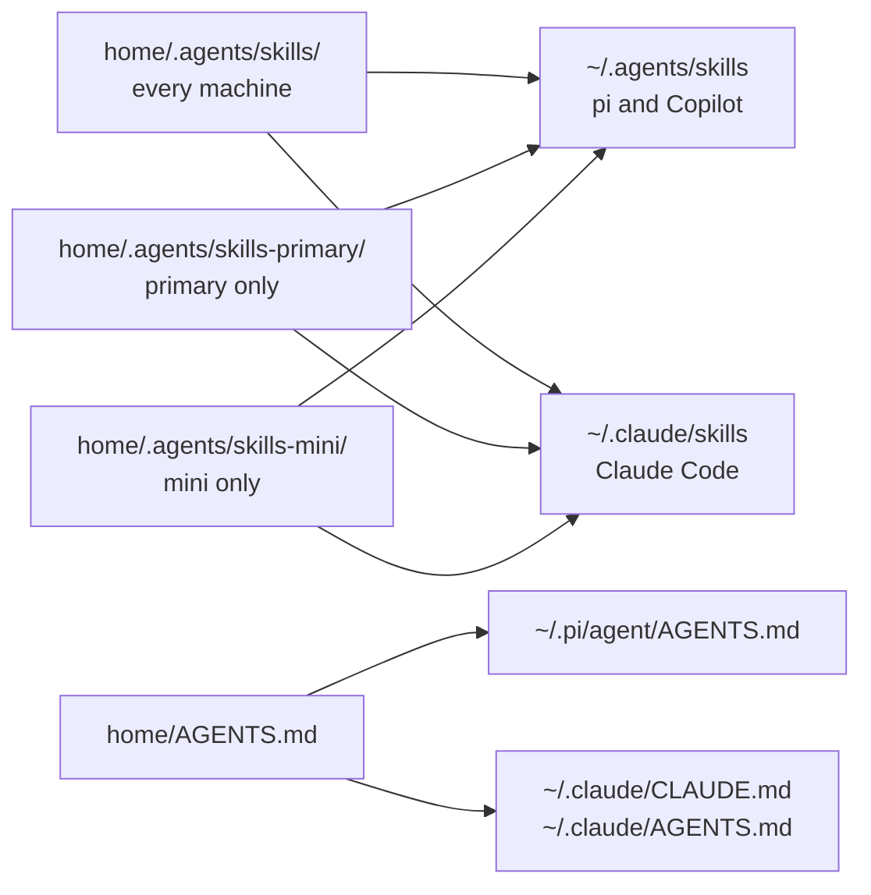
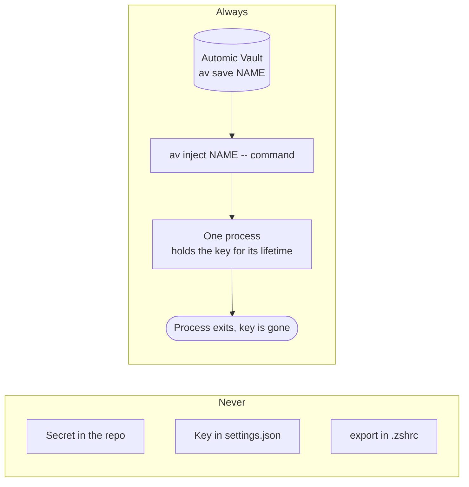
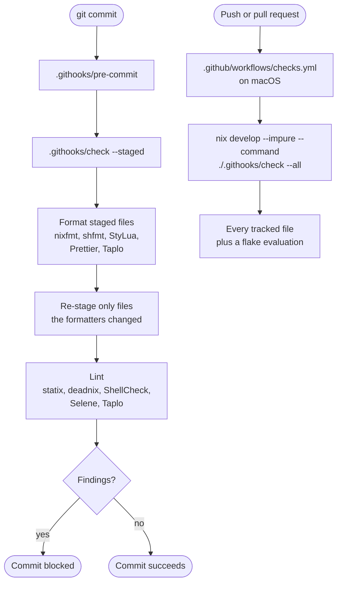
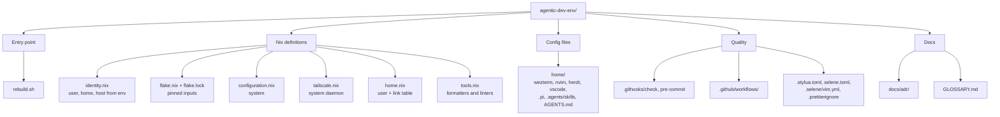

# agentic-dev-env

**A whole macOS dev machine, defined as code, with a built-in crew of AI coding agents.**

Run one script on a fresh Mac and you get your shell, editors, terminal, CLI tools, GUI apps, secrets handling and an agent setup (`mate`) that splits a request into parallel tasks and ships them with a crew of agents. Change a config file and, most of the time, it takes effect immediately with no rebuild.

> **New here?** Read [The idea](#the-idea), skim [The big picture](#the-big-picture), then jump to [Setup guide](#setup-guide). Unfamiliar terms are defined in [GLOSSARY.md](GLOSSARY.md).

## Contents

1. [The idea](#the-idea)
2. [The big picture](#the-big-picture)
3. [What you get](#what-you-get)
4. [Setup guide](#setup-guide)
5. [How a rebuild works](#how-a-rebuild-works)
6. [How config files reach your machine](#how-config-files-reach-your-machine)
7. [The agent crew](#the-agent-crew)
8. [Secrets](#secrets)
9. [Quality checks](#quality-checks)
10. [Day to day cheat sheet](#day-to-day-cheat-sheet)
11. [Repository layout](#repository-layout)
12. [Adapting this to your machine](#adapting-this-to-your-machine)
13. [Troubleshooting](#troubleshooting)
14. [Security scan findings](#security-scan-findings)
15. [Design decisions (ADRs)](#design-decisions-adrs)

---

## The idea

This repo does two jobs, and it helps to keep them separate in your head.

| Layer                 | What it does                                                                                                                                            | Built with                                                                                                                                   |
| --------------------- | ------------------------------------------------------------------------------------------------------------------------------------------------------- | -------------------------------------------------------------------------------------------------------------------------------------------- |
| **1. The machine**    | Declares everything installed and configured on a Mac: packages, apps, shell, editor and terminal configs, system settings.                             | [nix-darwin](https://github.com/nix-darwin/nix-darwin), [home-manager](https://github.com/nix-community/home-manager), Homebrew for GUI apps |
| **2. The agent crew** | Wires up AI agents on top of that machine: one harness (`pi`), one model provider, a coordinator (the _first mate_) and parallel workers (_crewmates_). | `pi`, [firstmate](https://github.com/kunchenguid/firstmate), herdr, Automic Vault                                                            |

Three principles run through the whole repo:

- **Everything is declarative.** The repo is the source of truth. Re-running the rebuild always converges on the same machine.
- **Edits are cheap.** Config files live in this repo and are _linked_ into `$HOME`, so most edits take effect without a rebuild.
- **Secrets never sit in the environment.** Every secret lives in Automic Vault and is handed to a process only for the life of that process.

## The big picture



**Reading the diagram:** you only ever run `rebuild.sh` (to build the machine) and `mate` (to use the crew). Everything in the middle is wiring that those two commands trigger.

## What you get

- **Packages (nix):** ripgrep, fd, fzf, jq, lazygit, neovim, Hack Nerd Font, the agent harness `pi` (from its own flake input), the Swift linters `swiftlint` and `swift-format` (both run with `--strict`), and the formatters and linters the commit hook runs: nixfmt, shfmt, stylua, prettier, taplo, statix, deadnix, shellcheck, selene.
- **Apps (Homebrew):** wezterm, Visual Studio Code, herdr, Node, Automic Vault (`av`, which holds every secret this machine needs), and the `automic-vault/isotopes/gh-cli` isotope that `av harden gh` installs.
- **Shell:** zsh with autosuggestions and syntax highlighting, the starship prompt, git aliases, the `mate` alias, and `~/.local/bin` on `PATH` (exported from `.zshrc`, because macOS `path_helper` rewrites `PATH` after `.zshenv`).
- **Configs:** wezterm, neovim, herdr, VS Code (font, terminal font, formatters), pi's agent directory (`~/.pi/agent/settings.json` is generated from `personal.nix` and owns the default model, `AGENTS.md` holds the global instructions), user-level skills under `~/.agents/skills` and `~/.claude/skills`, `~/.config/git/config` (resets Apple's ambient credential helper) and `~/.ssh/config` (Keychain-backed key).

## Setup guide

### Before you start

- A Mac (Apple Silicon or Intel) and an admin user. Nothing in the tree hardcodes the username: `identity.nix` reads it from the environment when the flake is evaluated. See [Adapting](#adapting-this-to-your-machine) if the defaults do not fit.
- An account with the model provider (a model API key).
- About 30 minutes, most of it waiting for the first build.

### Your personal values: `personal.nix`

Everything personal about this machine lives in one gitignored file at the repo root. No tracked file names a provider, a model, a secret or a repository:

```bash
cp personal.nix.example personal.nix   # then edit it
```

It holds the model and provider every agent starts on, the thinking levels, the supervision pin, the _name_ of the vault secret holding the model key, the upstream the host proxy forwards to, the GitHub App id, and the firstmate fork. A secret's name goes there; its value goes in Automic Vault. `nix/personal.nix` is the tracked loader: it merges your file over generic defaults, so a clone without `personal.nix` still evaluates. Because the file is untracked, `rebuild.sh` and `.githooks/check` export its absolute path as `AGENTIC_DEV_ENV_PERSONAL`; a flake in a git repo cannot see untracked files any other way.

The model files are generated from it at activation, so the model really is declared once: `~/.pi/agent/settings.json`, `~/firstmate/config/crew-dispatch.json` and the two supervision pins are rendered, not linked. Changing the model is an edit to `personal.nix` plus `./rebuild.sh`.

### The order of operations

The order matters. Cloning firstmate _before_ the first rebuild is the step people most often get wrong.



### Step 1: clone firstmate (manual, once)

```bash
git clone https://github.com/kunchenguid/firstmate ~/firstmate
```

Do this first. Activation creates `~/firstmate/config/` to hold the generated dispatch file, and `git clone` then refuses the non-empty directory. If you already ran the rebuild, `rm -rf ~/firstmate` (nothing is in it yet) and clone again.

Firstmate is cloned by hand because it updates itself (`/updatefirstmate`), so this repo deliberately never installs or updates it. `rebuild.sh` clones it from the fork named in `personal.nix` when `~/firstmate` is absent, so the fork is the one place a personal repository is named.

### Step 2: clone this repo, set your values, rebuild

```bash
git clone https://github.com/aditya-sathish-rao/agentic-dev-env.git ~/github/agentic-dev-env
cd ~/github/agentic-dev-env
cp personal.nix.example personal.nix   # then edit: model, provider, key secret, App id, fork
./rebuild.sh             # primary by default; --mini on the headless Mac mini
```

`rebuild.sh` is idempotent and is the only entry point, on a fresh machine and on an existing one. With no flag it builds `primary`, so a bare `./rebuild.sh` is right on the Mac you sit at; on the mini, pass `--mini`. See [How a rebuild works](#how-a-rebuild-works) for what it does. When it finishes, **open a new terminal**.

### Step 3: install the companion CLIs (manual, once)

Firstmate's helper CLIs are not in nixpkgs, so they come from their own installers. This machine runs gh-axi 0.1.51, chrome-devtools-axi 0.1.46, tasks-axi 0.2.6, quota-axi 0.1.69, lavish-axi 0.1.97, treehouse 3.1.8 and no-mistakes v1.106.1.

```bash
npm install -g gh-axi chrome-devtools-axi tasks-axi quota-axi lavish-axi
gh-axi setup hooks && chrome-devtools-axi setup hooks && lavish-axi setup hooks
curl -fsSL https://kunchenguid.github.io/treehouse/install.sh | sh
curl -fsSL https://raw.githubusercontent.com/kunchenguid/no-mistakes/main/docs/install.sh | sh
```

`~/.local/bin` is already on `PATH`, so the treehouse and no-mistakes installers write there instead of asking to `sudo` into `/usr/local/bin`.

The three `setup hooks` lines install SessionStart hooks for Claude Code, Codex, OpenCode and Copilot CLI. Pi is not one of those targets, so they do not reach the first mate. It gets the same guidance from the `lavish` skill under `~/.agents/skills` and by calling the `-axi` CLIs directly. Keep those lines only if you also run one of those harnesses.

### Step 4: Automic Vault manual steps (once per Mac)

These are the steps Automic Vault only lets a human do. They are not automated.

1. **Start the app.** Homebrew installs it but nothing launches it, and every `av` command that needs Approval fails with `approval service is not running` until the menu bar app is up.

   ```bash
   open -a "Automic Vault"
   ```

   Grant the permission prompts (notifications, and Keychain access for the Data Protection Keychain that stores the secrets). Leave it running.

2. **Install the `av` CLI.** In the app choose **Install av CLI**. It authenticates as admin and writes a root-owned `/usr/local/bin/av`. It refuses to install into a directory you own, so if `/usr/local/bin` is user-owned, fix that and click Install again:

   ```bash
   sudo chown root:wheel /usr/local/bin
   ```

3. **Store the model key.**

   ```bash
   av save MODEL_API_KEY   # hidden input, then approve the prompt
   ```

   The key now lives only in Automic Vault and reaches every agent through `av inject`.

4. **Let the terminal inject it.** In the app: select `MODEL_API_KEY`, then **Allow Launcher**, then WezTerm. Without this, `av inject` asks for Approval on every launch.

5. **Harden `gh`.** The isotope is declared in `configuration.nix`, but it does not migrate or gate anything until you run the hardener:

   ```bash
   av harden gh
   av doctor gh   # should report healthy
   ```

   Then delete the legacy `github.com` Internet password item in Keychain Access so nothing can read that token directly. Dispatching clones projects and opens PRs, so `mate` cannot do anything until `av doctor gh` is healthy.

6. **Encrypt the SSH key.** `av scan` reports `~/.ssh/id_ed25519` as a HIGH finding while it has no passphrase, and only you can type the new one:

   ```bash
   ssh-keygen -p -f ~/.ssh/id_ed25519
   ssh-add --apple-use-keychain ~/.ssh/id_ed25519
   ```

   `~/.ssh/config` is managed with `AddKeysToAgent` and `UseKeychain`, so the passphrase is stored in the macOS Keychain once and push and pull keep working without retyping it.

### Step 5: run the crew

```bash
mate
```

The first launch reports anything still missing as `MISSING:` and asks before installing or upgrading it.

### Setup checklist

- [ ] firstmate cloned to `~/firstmate` (before the first rebuild)
- [ ] `./rebuild.sh` completed and a new terminal opened
- [ ] companion CLIs installed
- [ ] Automic Vault running, `av` installed
- [ ] `MODEL_API_KEY` saved and the launcher allowed
- [ ] `av doctor gh` healthy
- [ ] SSH key has a passphrase
- [ ] `mate` starts with no `MISSING:` lines

## How a rebuild works

`./rebuild.sh` (or `--mini`) builds as **you** and activates as **root**. Building as the user keeps the (impure) flake evaluation tied to whoever runs it. Only the final activation needs root, so you see exactly one `sudo` prompt. The reasoning is in [ADR-0004](docs/adr/0004-build-as-user-activate-as-root.md).

With no flag the host defaults to `primary`, so a bare `./rebuild.sh` works on the Mac you sit at. The mini has to ask for itself with `--mini`, because the default would build the wrong machine there. A flag that disagrees with `AGENTIC_DEV_ENV_HOST` is an error rather than a silent override.



A few details worth knowing:

- The script refuses to nest if `~/.agentic-dev-env` is already a real directory.
- The flake is evaluated impurely, so the darwin configuration belongs to whoever runs the script.
- Home-manager runs **last**. A failure before it leaves the system switched but the user links untouched.
- `home-manager.backupFileExtension = "hm-bak"` (in `flake.nix`) means a plain file at a managed path, such as an old generated `~/.config/git/config`, is moved to `<path>.hm-bak` instead of aborting every link.

## How config files reach your machine

Not every config file is delivered the same way. There are three delivery modes, and knowing which one a file uses tells you whether an edit needs a rebuild.



| Mode          | Used for                                                                   | To change it                                                                               |
| ------------- | -------------------------------------------------------------------------- | ------------------------------------------------------------------------------------------ |
| **Linked**    | wezterm, neovim, herdr, pi settings, `AGENTS.md`, skills, firstmate config | Edit the file in the repo. **No rebuild.**                                                 |
| **Generated** | `~/.config/git/config`                                                     | Edit `home.nix`, then `./rebuild.sh` (or `--mini`)                                         |
| **Seeded**    | VS Code `settings.json`                                                    | VS Code owns it after the first seed. Delete it and run `./rebuild.sh` to restore defaults |

VS Code is the odd one out because its atomic saves cannot write through a link into the read-only Nix store. See [ADR-0008](docs/adr/0008-vscode-owns-its-settings.md).

## The agent crew

> _Talk to one agent, ship with a crew._

### Cast

| Role                   | What it is                                                                                                                                                            |
| ---------------------- | --------------------------------------------------------------------------------------------------------------------------------------------------------------------- |
| **`mate`**             | A shell alias that launches the first mate with the right environment.                                                                                                |
| **First mate**         | `pi` running inside your clone of [firstmate](https://github.com/kunchenguid/firstmate) at `~/firstmate`. You talk to it. It splits a request into parallel tasks.    |
| **Crewmates**          | Worker agents, one per task, each in its own herdr tab and its own git worktree.                                                                                      |
| **Supervision branch** | A second, cheaper conversation beside your chat that triages fleet wake-ups, so the first mate is only interrupted by things that matter.                             |
| **`pi`**               | The one agent harness. Its package ships its own Node runtime and model catalog, so there is no global npm install and its version moves only when `flake.lock` does. |
| **herdr**              | The terminal multiplexer that hosts the tabs and panes.                                                                                                               |

### What happens when you run `mate`



Key things this shows:

- The **first mate** gets its key from `mate`. **Crewmates** get theirs from the `pi` wrapper, because herdr's server never saw the key. Each worker holds it only while it runs, and if `av` fails the launch stops instead of running signed out.
- Fleet polling never reaches a model. A bash watcher blocks on herdr's event stream, absorbs benign wake-ups itself, and wakes the supervision branch only for a real transition or decision.

### Model and effort settings



- `personal.nix` is the single source. `nix/personal.nix` merges it over generic defaults and hands it to every module as `personal`.
- `~/.pi/agent/settings.json` is generated from it and owns the model every agent starts on: `defaultProvider`, `defaultModel`, `defaultThinkingLevel`. To try another model, edit `personal.nix` and run `./rebuild.sh`. The file is generated rather than linked because pi writes `lastChangelogVersion` into it, so a hand edit would be overwritten anyway.
- `~/firstmate/config/crew-dispatch.json` is generated too. It declares one profile and deliberately omits the model, so crewmates inherit the `settings.json` default. With `shared_quota: true`, the `quota-array-dispatch` skill resolves the declared profile in order and makes no quota call, since there is one provider and one budget.
- `supervision-branch-model` and `-effort` pin the supervision branch to the `model.supervision` values at `low` effort, while the captain keeps `high`. Routine triage is cheap, and anything captain-worthy still reaches the main conversation. A pin applies when the next `mate` session opens. `/supervision-model` rewrites these files in place, so run `./rebuild.sh` afterwards to put the declarative pins back.

### What a rebuild automates and what it does not

| Automated by `./rebuild.sh`                                                                              | Manual, once                         |
| -------------------------------------------------------------------------------------------------------- | ------------------------------------ |
| `pi` from the flake input                                                                                | Clone firstmate                      |
| herdr from Homebrew                                                                                      | Install the companion CLIs           |
| Generated model files (`settings.json`, `crew-dispatch.json`, supervision pins) and the `AGENTS.md` link | Store the key and allow the launcher |
| `~/.local/bin` on `PATH`                                                                                 | Harden `gh`                          |
| The `mate` alias in `.zshrc`                                                                             | Encrypt the SSH key                  |

Homebrew no longer prunes, so the `claude-code` cask from the old harness survives a rebuild. Run `brew uninstall --cask claude-code` once. The `opencode` package needs nothing, because it came from nix and activation replaces the profile.

### Global instructions and skills

`home/AGENTS.md` is the single copy of the global agent instructions. Pi reads it as `~/.pi/agent/AGENTS.md`. The `~/.claude/CLAUDE.md` and `~/.claude/AGENTS.md` links are kept for any agent that still looks there.

Skills live under `home/.agents/skills`. Every directory there is linked one level deep into both `~/.agents/skills` (pi and Copilot) and `~/.claude/skills` (Claude Code), so **adding a skill needs no change to `home.nix`**.

A skill that belongs to one machine only goes in `home/.agents/skills-primary` or `home/.agents/skills-mini`. Those directories are linked the same way, but only on the host they name, so a skill in `skills-primary` never appears on the mini. The host comes from the configuration name in `flake.nix`, not from the environment, so CI still evaluates both directories.



Vendored skills are re-copied here to update: `lavish` (MIT, from [kunchenguid/lavish-axi](https://github.com/kunchenguid/lavish-axi)), `stow`, the pstack set (`bro`, `teach`, and the `principle-*` leaves in `software-engineering-principles/`), and the 27 skills of [mattpocock/skills](https://github.com/mattpocock/skills) (MIT, pinned at `49dd158d1076134a641b33efb035946536778336`, the commit the `mattpocock-skills` entry in Anthropic's `claude-plugins-official` marketplace resolves to). Upstream's `teach` is vendored as `matt-pocock-teach`, because the pstack `teach` already owns that name.

The engineering principles apply to every agent and task. Their leaves stay exactly as pstack ships them, including `disable-model-invocation: true`, so the local `engineering-principles` skill is the model-invocable index that routes to them, and `home/AGENTS.md` makes that index mandatory for harnesses that do not surface skills. See [ADR-0007](docs/adr/0007-engineering-principles-are-skills.md).

## Secrets

**Policy:** every secret lives in Automic Vault. No secret in this repo, none in `~/.pi/agent/settings.json`, none exported from `.zshrc`.

Code that needs a secret gets it per launch, so it is never ambient in the environment:

```bash
av inject <name> -- command
```



Pi reads its model key from `MODEL_API_KEY`, and `av inject` supplies it for the life of one process. There is no pi hardener, so the launch is where the key enters. The reasoning is in [ADR-0005](docs/adr/0005-pi-only-harness.md). `mate` expands to:

```bash
av inject +MODEL_API_KEY -- env FM_BACKEND=herdr pi
```

If a secret ever reaches git history, a stale file or a log, **rotate it at the provider** and `av save` the new value. Rewriting history is not a fix, because the old value stays readable wherever it was copied.

Need a new tool that uses a secret? Start it through `av inject`, not an exported variable. If a registry token is ever needed, `av save` it and inject it the same way instead of writing `~/.npmrc`.

## Quality checks

Every commit is formatted and linted automatically, and CI runs the same checks.



```bash
.githooks/check --staged   # changed files, what the hook runs (the default)
.githooks/check --all      # every tracked file, plus a flake evaluation
```

- `--staged` leaves unstaged hunks in a partially staged file out of the commit.
- `--all` also evaluates the flake, which catches Nix errors that formatting and linting cannot. The evaluation is skipped when `nix` is not on `PATH`.
- CI uses the dev shell, which takes its tools from the pinned `nixpkgs` input, so CI and your machine run the same versions even before `./rebuild.sh` has installed anything.
- `rebuild.sh` sets `core.hooksPath` for you. On any other clone, run `git config core.hooksPath .githooks`.

## Day to day cheat sheet

| I want to...                                                     | Do this                                                                                                                                                  |
| ---------------------------------------------------------------- | -------------------------------------------------------------------------------------------------------------------------------------------------------- |
| Apply a change to `home.nix`, `configuration.nix` or `flake.nix` | `./rebuild.sh` (or `--mini`)                                                                                                                             |
| Change wezterm, neovim, herdr, pi or skill configs               | Edit the file under `home/`. No rebuild                                                                                                                  |
| Change the default model                                         | Edit `personal.nix`, then `./rebuild.sh`                                                                                                                 |
| Change VS Code settings                                          | Edit `home/.config/vscode/settings.json`, delete `~/Library/.../settings.json` (the real file), then `./rebuild.sh`                                      |
| Change git config                                                | Edit `home.nix`, then `./rebuild.sh` (or `--mini`)                                                                                                       |
| Update pi                                                        | `nix flake update pi`, then `./rebuild.sh` (or `--mini`). **Do not** run `pi update pi`: the installed copy lives in the read-only store                 |
| Update the Automic Vault tap                                     | `nix flake update automic-vault-tap`, then `./rebuild.sh` (or `--mini`)                                                                                  |
| Add a skill for every machine                                    | Add a directory under `home/.agents/skills`. No `home.nix` change                                                                                        |
| Add a skill for one machine only                                 | Add a directory under `home/.agents/skills-primary` or `home/.agents/skills-mini`. No `home.nix` change                                                  |
| Add a new config file                                            | Add a `$HOME`-relative target and repo path to the link table in `home.nix` via `config.lib.file.mkOutOfStoreSymlink`, then `./rebuild.sh` (or `--mini`) |
| Add a Homebrew app                                               | Add it to `configuration.nix`, then `./rebuild.sh` (or `--mini`)                                                                                         |
| Remove a Homebrew app                                            | Remove it from `configuration.nix`, **and** `brew uninstall --cask <name>` (Homebrew is additive)                                                        |
| Store or rotate a secret                                         | `av save NAME`                                                                                                                                           |
| Run the checks by hand                                           | `.githooks/check --all`                                                                                                                                  |

## Repository layout



```text
identity.nix          username, home directory and host, read from the environment
tools.nix             formatters and linters, shared by home.nix and the dev shell
flake.nix             inputs pinned by flake.lock (nixpkgs, nix-darwin, home-manager,
                      nix-homebrew, automic-vault/isotopes tap, pi); evaluated impurely
configuration.nix     system: macOS defaults, fonts, homebrew taps/brews/casks
tailscale.nix         system: the Tailscale daemon
home.nix              user: packages, zsh, starship, link table, rendered VS Code settings
home/                 the config files (wezterm, nvim, herdr, vscode, .pi, .agents/skills, AGENTS.md)
docs/adr/             one record per decision that is not obvious from the code
GLOSSARY.md           shared terms
rebuild.sh            the only entry point: fresh machine, or re-apply changes (primary by default)
.githooks/check       formatter and lint module (--staged, --all)
.githooks/pre-commit  git hook, calls check --staged
.github/workflows/    CI that runs check --all on macOS
.stylua.toml          Lua formatting style shared with the StyLua extension
selene.toml           Lua lint rules (.selene/vim.yml defines Neovim globals)
.prettierignore       generated and vendored files Prettier should skip
```

## Adapting this to your machine

Most of this needs no changes, because the identity is dynamic.

- **Another user, home or host.** Set `AGENTIC_DEV_ENV_USER`, `AGENTIC_DEV_ENV_HOME` and `AGENTIC_DEV_ENV_HOST`. `AGENTIC_DEV_ENV_HOST` names the `darwinConfigurations` attribute, not the machine hostname, and must agree with the `--primary`/`--mini` flag.
- **Another config file.** See the [cheat sheet](#day-to-day-cheat-sheet). A file whose content Nix generates is rendered or seeded instead of linked, depending on whether the application itself writes it.
- **Homebrew is additive.** With `homebrew.onActivation.cleanup = "none"`, `brews` and `casks` are installed and upgraded and everything else on the machine is left alone. The price: deleting an entry here does not uninstall it. Run `brew uninstall --cask <name>` (or `brew zap <name>`). See [ADR-0006](docs/adr/0006-homebrew-is-additive.md).
- **The Automic Vault tap.** The cask is not in homebrew-cask, so its tap is a flake input (`automic-vault-tap`, `flake = false`) installed by `nix-homebrew.taps`. Taps stay mutable on purpose, and the cask entry must stay fully qualified and `trusted`. See [ADR-0001](docs/adr/0001-homebrew-taps-stay-mutable.md).
- **A different model or provider.** Edit `personal.nix` (the model, provider and supervision pin all live there), then `./rebuild.sh`. The model files are generated, so a hand edit to `~/.pi/agent/settings.json` is replaced on the next activation.

## Troubleshooting

| Symptom                                                        | Cause                                                            | Fix                                                                                                      |
| -------------------------------------------------------------- | ---------------------------------------------------------------- | -------------------------------------------------------------------------------------------------------- |
| `approval service is not running` from any `av` command        | The Automic Vault menu bar app is not running                    | `open -a "Automic Vault"` and leave it running                                                           |
| `av` asks for Approval on every `mate` launch                  | The terminal has not been granted access to the key              | In the app: `MODEL_API_KEY`, then **Allow Launcher**, then WezTerm                                       |
| **Install av CLI** refuses to install                          | `/usr/local/bin` is owned by your user                           | `sudo chown root:wheel /usr/local/bin`, then click Install again                                         |
| `git clone` of firstmate fails with a non-empty directory      | The rebuild ran first and created `~/firstmate/config/`          | `rm -rf ~/firstmate` (it is empty of real content), then clone again                                     |
| `rebuild.sh` stops right after starting an installer           | Xcode command line tools were missing                            | Wait for the installer, then re-run `./rebuild.sh`                                                       |
| `rebuild.sh` built the wrong machine                           | No flag was given, so it defaulted to `primary`                  | Pass `--mini` on the mini                                                                                |
| `rebuild.sh` says the flag conflicts with the env var          | `AGENTIC_DEV_ENV_HOST` disagrees with the flag                   | Drop one of them, or make them agree                                                                     |
| `rebuild.sh` refuses to link `~/.agentic-dev-env`              | `~/.agentic-dev-env` is already a real directory                 | Move or remove that directory, then re-run                                                               |
| A config file became `<path>.hm-bak`                           | A plain file was in the way of a managed link                    | Expected. Diff it against the new link, keep what you need, delete the backup                            |
| `mate` prints `MISSING:` lines                                 | A companion CLI is not installed                                 | Install it as in [Step 3](#step-3-install-the-companion-clis-manual-once), or approve what `mate` offers |
| `mate` cannot clone or open PRs                                | `gh` is not hardened or healthy                                  | `av harden gh`, then `av doctor gh`                                                                      |
| A crewmate pane exits immediately                              | `av` failed, and the wrapper stops instead of running signed out | Check the vault app is running and the launcher is allowed                                               |
| VS Code settings changes from the repo are ignored             | VS Code owns its real settings file after the first seed         | Delete the real file and run `./rebuild.sh` (or `--mini`)                                                |
| `pi update pi` fails                                           | The installed copy is in the read-only store                     | `nix flake update pi`, then `./rebuild.sh` (or `--mini`)                                                 |
| An app you removed from `configuration.nix` is still installed | Homebrew is additive                                             | `brew uninstall --cask <name>`                                                                           |

## Security scan findings

<details>
<summary><code>av scan</code> on 2026-11-16, and what each finding became</summary>

| Finding                                                   | Severity     | Status                                                                                                                                      |
| --------------------------------------------------------- | ------------ | ------------------------------------------------------------------------------------------------------------------------------------------- |
| `gh-cli-keychain-access`: gh token readable by `security` | HIGH         | Fixed: the isotope is declared and `av harden gh` gates the command (see [Step 4](#step-4-automic-vault-manual-steps-once-per-mac), item 5) |
| `git-credential-fill`: ambient helper for github.com      | HIGH         | Fixed: `~/.config/git/config` resets Apple's `osxkeychain` helper, the cached `github.com` item is gone, remotes use SSH                    |
| `emudhra`: CA bundled in `/usr/local/bin/node`            | HIGH         | Fixed: the stale standalone Node 22 was removed and `node` comes from Homebrew                                                              |
| `openssh`: `~/.ssh/id_ed25519` has no passphrase          | HIGH         | Manual: see [Step 4](#step-4-automic-vault-manual-steps-once-per-mac), item 6                                                               |
| `sudo` without Touch ID                                   | medium       | Fixed: `security.pam.services.sudo_local.touchIdAuth` writes `/etc/pam.d/sudo_local`                                                        |
| OpenRouter key in `~/.claude/settings.json`               | not detected | Fixed: moved to Automic Vault and injected by `mate`; that file is no longer tracked                                                        |

Seven medium items remain. Six are `PATH` ordering (`/opt/homebrew/bin`, `/opt/homebrew/sbin`, `~/.nix-profile/bin`, each reported by the shell detector and again by the macOS process detector), which is the ordering nix-darwin and `brew shellenv` exist to produce. The seventh is the `homebrew` detector flagging `/opt/homebrew` as writable by the current user, an accepted risk explained in [ADR-0003](docs/adr/0003-accepted-homebrew-writable-risk.md).

The npm and pnpm token detectors are present but report nothing today.

</details>

## Design decisions (ADRs)

Decisions that are not obvious from the code are recorded in [`docs/adr/`](docs/adr).

| ADR                                                        | Decision                                        |
| ---------------------------------------------------------- | ----------------------------------------------- |
| [0001](docs/adr/0001-homebrew-taps-stay-mutable.md)        | Homebrew taps stay mutable                      |
| [0003](docs/adr/0003-accepted-homebrew-writable-risk.md)   | Accepted risk: `/opt/homebrew` is user-writable |
| [0004](docs/adr/0004-build-as-user-activate-as-root.md)    | Build as the user, activate as root             |
| [0005](docs/adr/0005-pi-only-harness.md)                   | Pi is the only agent harness                    |
| [0006](docs/adr/0006-homebrew-is-additive.md)              | Homebrew is additive, never prunes              |
| [0007](docs/adr/0007-engineering-principles-are-skills.md) | Engineering principles are skills               |
| [0008](docs/adr/0008-vscode-owns-its-settings.md)          | VS Code owns its settings file                  |

## Glossary

Shared terms (first mate, crewmate, isotope, harness, and so on) are defined in [GLOSSARY.md](GLOSSARY.md).
