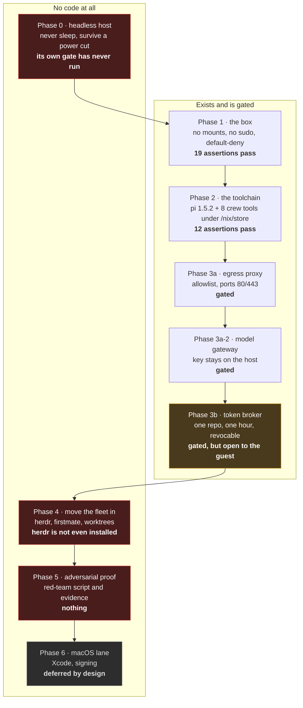

# Crew sandbox: plan vs. code review

Reviewed 21 November 2026. Plan: [`crew-sandbox-plan-revised.md`](.lavish/crew-sandbox-plan-revised.md).
Code: [`nix/crew-sandbox/`](nix/crew-sandbox) at `324c119`, plus the uncommitted `GLOSSARY.md` edit.

This is a review, not a rewrite. Every finding below was reproduced against the running
`crew` VM or read out of the source; nothing here is inferred from the plan alone.

---

## 1. How this was checked

Read: `default.nix`, `lima.yaml`, `guest.nix`, `crew-sandbox.sh`, `check.sh`, all six
`checks/*.sh`, `proxy.mjs`, `broker/broker.mjs`, `egress-allow`, `repos-allow`,
`guest/models.json`, `guest/settings.json`, `docs/README.md`, `docs/adr/0010`, `flake.nix`,
`home.nix`, `.githooks/check`, both CI workflows.

Ran against the live VM:

| Command                                                                          | Result                                                                                                                    |
| -------------------------------------------------------------------------------- | ------------------------------------------------------------------------------------------------------------------------- |
| `crew-sandbox check` (phase 1)                                                   | **pass**, 19 assertions                                                                                                   |
| `crew-sandbox check toolchain` (phase 2)                                         | **pass**, pi 1.5.2, all 8 crew tools under `/nix/store`                                                                   |
| `crew-sandbox check proxy`                                                       | **pass** after the `api.github.com` fix, including the new assertion                                                      |
| `proxy.mjs` with a dummy key + the real guest token, then `pi -p` from the guest | **pass**: request reached DeepSeek, got a real `401` for the dummy key, proxy logged `ALLOW model POST /chat/completions` |
| `git clone` through the proxy                                                    | **pass**: 55 884 files                                                                                                    |
| `curl -x proxy https://api.github.com/`                                          | **fail** before the fix, `403`; **pass** after, `200`                                                                     |
| guest → host `:3129` with `--noproxy`                                            | **reachable**, and the real `/token` route reads no credential                                                            |
| agent pre-owns `/tmp/crew-root-checks.sh`, then gate runs                        | **gate exits 23**, planted script does _not_ run as root                                                                  |
| `prettier --check` on both `.mjs`                                                | **fail**, and the hook never sees them                                                                                    |
| `nix eval .#packages.aarch64-darwin.crew-sandbox`                                | resolves; no CI job ever builds it                                                                                        |

**Not run:** `check model` and `check broker`. They need `av` vault approval and a real GitHub
App key. Their _components_ were exercised by hand instead — the gateway with a dummy key and
the real guest token, the broker's route table by reading it and probing reachability — which
is why the findings below are about those components rather than the gate wrappers.

---

## 2. Verdict

The boundary that exists is real and it holds: no mounts, no sudo, default-deny egress,
no host credentials in the guest, and the model key genuinely stays on the host. That is
more than most agent sandboxes ever get to.

What is missing is the part that makes the boundary _authoritative_ rather than _advisory_.
Two edges are wrong in opposite directions: one door is too wide (the broker) and one is
shut that should be open (`api.github.com`). Phase 0 and Phase 4 — the two phases the plan
calls load-bearing — have no code at all.

|            | Count            |
| ---------- | ---------------- |
| Critical   | 2 (1 fixed here) |
| High       | 4                |
| Medium     | 9                |
| Low / nits | 12               |

Do **C1** before anything else; it is a one-flag firewall change with outsized effect. **C2**
was fixed in this pass and verified against the live VM.

### Phase coverage at a glance

The plan has six phases. This is what actually exists behind each one.



The plan's order of work puts Phase 0 first. Nothing behind it exists, so the power-cut test
the plan calls the gate cannot be attempted. Phase 3b is gated but not enforced: the gate
proves the token is scoped, and the firewall leaves the broker reachable by any crewmate
(C1).

---

## 3. Findings

### Critical

#### C1. The token broker is unauthenticated and reachable from the guest

The plan's central credential claim is _"a host-side broker mints a GitHub App installation
token per task."_ The broker is a host service that any crewmate can call itself.

**Evidence.**

- [`lima.yaml:111`](nix/crew-sandbox/lima.yaml) allows `ip daddr $gw tcp dport 3129 accept`
  — the guest firewall is explicitly configured to reach the broker.
- [`broker.mjs:237`](nix/crew-sandbox/broker/broker.mjs) binds `127.0.0.1:3129`, which Lima
  forwards to the guest gateway.
- [`broker.mjs:153`](nix/crew-sandbox/broker/broker.mjs) — the `/token` handler reads
  `task` and `repo`, checks `repos`, mints, and returns. It never reads an `Authorization`
  header. Confirmed by reading the handler: no credential check exists anywhere on the route.
- Reachability proven empirically: a stand-in listener on `127.0.0.1:3129` answered
  `GET /health` → `200` and `POST /token` → `200` from inside the guest with `--noproxy '*'`.

**Impact.** Every crewmate runs as the same `agent` user, so nothing distinguishes a
crewmate from the first mate. Any of them can mint a real installation token for any
repository in `repos-allow`, with no task binding and no first-mate involvement. The
per-task property is enforced by convention only. `POST /revoke-all` is equally open, so a
crewmate can also revoke the whole fleet's tokens at will.

**Fix.** Pick one, in this order of preference:

1. **Close the port until the consumer exists.** Drop `3129` from the output chain in
   `lima.yaml` and add it back in Phase 4, together with the spawn path that injects a
   per-task secret into the pane. Today the broker is an operator tool; the firewall should
   say so. Update `checks/root.sh` to assert 3128 is the _only_ reachable port.
2. **Authenticate it.** At spawn, the host writes a random per-task secret into the pane's
   environment and registers it with the broker; `/token` requires
   `Authorization: Bearer <that secret>` and refuses a `repo` that does not match the
   secret's task. This is the plan's actual design and it is not implemented.
3. **Bind to a unix socket** in a directory the guest cannot reach, and have the host inject
   the path.

Do (1) now, (2) in Phase 4. Also gate `/revoke-all` behind the same credential.

#### C2. `api.github.com` is not in `egress-allow`, so the crew's GitHub API path is dead — **fixed and verified**

**Evidence (before the fix).**

```console
guest$ curl -x http://192.168.5.2:3128 https://api.github.com/
curl: (7) CONNECT tunnel failed, response 403
proxy: 2026-11-20T23:59:58.337Z DENY api.github.com:443
```

`egress-allow` named `github.com`, `.codeload.github.com`, `.raw.githubusercontent.com`,
`.release-assets.githubusercontent.com`, `.objects.githubusercontent.com` — and no
`api.github.com`. `git clone`/`git push` over `github.com:443` worked; the REST API did not.

**Impact.** `gh-axi` and `no-mistakes` are crew tools that talk to the REST API. Phase 4
moves the fleet in and Phase 5 expects crewmates to open pull requests. Push works; PRs,
reviews and issue reads do not. This is the exact class of failure that a phase gate should
have caught and did not (see H2).

**Fix applied.** One line in [`egress-allow`](nix/crew-sandbox/egress-allow), with its
reason, plus an assertion in [`checks/proxy.sh`](nix/crew-sandbox/checks/proxy.sh) so the
omission cannot come back:

```bash
code=$(curl -sS -m 15 -o /dev/null -w '%{http_code}' -x "$proxy" \
  https://api.github.com/ 2>/dev/null || echo 000)
if [[ "$code" != 000 && "$code" != 403 ]]; then
  pass "the GitHub API answers through the proxy (${code})"
else
  flunk "the GitHub API answers through the proxy (got ${code}); add api.github.com to egress-allow"
fi
```

**Verified** by rerunning the real gate against the live VM:

```console
ALLOW api.github.com:443 from 127.0.0.1
PASS  the GitHub API answers through the proxy (200)
```

Note that the assertion accepts any non-`000`/non-`403` answer. GitHub replies `200` to an
unauthenticated `GET /`, but a `401` would also mean the host was reached, which is the only
thing this gate is about.

---

### High

#### H1. Gate scripts are copied into agent-writable `/tmp` and run as root

[`check.sh:101`](nix/crew-sandbox/check.sh) does `limactl copy <script> crew:/tmp/...`
and then [`check.sh:161`](nix/crew-sandbox/check.sh) runs
`sudo -n bash /tmp/crew-root-checks.sh`. The destination is world-writable and the guest's
`agent` user can pre-create it.

**Evidence.** With a regular file planted by `agent` at that exact path:

```console
rsync: [receiver] rename "/tmp/.crew-root-checks.sh.AGQmWG" -> "crew-root-checks.sh": Operation not permitted (1)
gate exit=23
GATEHIJACK absent
```

With a directory planted there: `mkstemp ... Permission denied (13)`, exit 23.

**Impact.** Today it **fails closed** — the planted script never executes, and a clean copy
lands as `crew:crew 644` which the agent cannot rewrite. So this is not a live root
escalation. It is two real problems anyway:

1. **Denial.** A crewmate can make `crew-sandbox check` unusable exactly when the operator
   needs it to judge the box, and the output is an rsync error rather than a tampering
   signal. The operator reads "infrastructure broke", not "the guest interfered".
2. **Latent escalation.** The moment anyone changes the copy to `--delete`, `cp`, or a
   `curl | bash`, the same agent-writable path becomes root code execution. The design
   should not depend on rsync's refusal to clobber.

**Fix.** Copy into a root-owned directory the agent cannot write, created by the provision
script:

```text
install -d -o root -g root -m 0755 /run/crew-gate
```

then `limactl copy <script> crew:/run/crew-gate/`, `install -m 0755` into place as root, and
add a gate assertion that `/run/crew-gate` is root-owned and not agent-writable. Also treat a
non-zero `limactl copy` as a hard, named failure ("the guest interfered with the gate")
rather than letting `set -e` surface rsync's exit code.

#### H2. The phase gates do not compose

`check model` starts a keyed proxy but never runs `checks/proxy.sh`; only
`phase == proxy` copies it ([`check.sh:163`](nix/crew-sandbox/check.sh)). `check toolchain`
likewise asserts nothing about egress. There is no `check all`.

**Impact.** An operator can run `check model`, see pass, and believe the boundary holds —
while the allowlist is wrong (C2) and the broker is open (C1). Each gate is correct in
isolation and the combination is what ships.

**Fix.** Add `check all` that runs every phase in one session, and make `check model` also
execute the allowlist assertions. The phase-1 checks already run on every invocation, so the
precedent exists; extend it.

#### H3. `nix-store --verify` is not an integrity check, and the agent owns the store

**Evidence.** `/nix` and `/nix/store` are `agent:agent 755`; `test -w /nix/store` succeeds.
[`checks/toolchain.sh:34`](nix/crew-sandbox/checks/toolchain.sh) runs
`nix-store --verify` without `--check-contents`.

**Impact.** "Every tool resolves under `/nix/store`" proves _location_, not _provenance_. A
crewmate can replace its own `pi`, `treehouse` or `no-mistakes` with anything, and the gate
still passes. The blast radius is bounded — it only compromises the guest, which is already
the untrusted side — but the docs claim a pinning guarantee the mechanism does not provide.

**Fix.** Either say plainly in `docs/README.md` that single-user Nix means the store is
agent-owned and the pins protect against _drift_, not _tampering_; or run
`nix-store --verify --check-contents` and accept the cost; or move to a root-owned store with
a daemon (which contradicts the "no root afterwards" choice and needs a real decision, not a
patch).

#### H4. Phase 0 and Phase 4 have no code

**Evidence.**

- No `pmset`, autologin, FileVault or never-sleep handling in `configuration.nix`,
  `home.nix` or `flake.nix`. Phase 0's own gate — cut power, come back — cannot be attempted.
- Guest has no `herdr`, no `gh`, no git identity (`git config --global user.email` → unset),
  and `~/agentic-dev-env` is **not a git repository** — it contains AppleDouble `._*` files,
  which means files were copied in by some earlier, unrecorded route.

**Impact.** The plan's order of work puts Phase 0 first and Phase 4 immediately after
authority. Neither exists. `check toolchain` passes while the fleet's actual runtime is
absent, so the gate reports readiness that is not there.

**Fix.** Decide Phase 0's shape: implement never-sleep and restart-after-power-failure in
`configuration.nix` (reproducible) or record it as explicit operator steps in the plan. For
Phase 4, add `herdr`, a git identity and a pinned `firstmate` to
[`guest.nix`](nix/crew-sandbox/guest.nix), then assert them in `checks/toolchain.sh` —
including a check that `herdr` runs.

---

### Medium

| #   | Finding                                                                                                                                                                                                                   | Evidence                                                     | Fix                                                                                                                 |
| --- | ------------------------------------------------------------------------------------------------------------------------------------------------------------------------------------------------------------------------- | ------------------------------------------------------------ | ------------------------------------------------------------------------------------------------------------------- |
| M1  | Nothing applies `guest.nix`. No `home-manager switch` appears anywhere in the repo or docs, so the guest toolchain exists only because someone ran it by hand.                                                            | `grep -rn "home-manager switch"` → nothing                   | A `crew-sandbox apply` subcommand that runs the pinned generation, plus a check that the active generation matches. |
| M2  | `.githooks/check` never looks at `.mjs`. `file_type()` has no `*.mjs` case, so `proxy.mjs` and `broker.mjs` are never formatted or linted.                                                                                | `prettier --check` fails on both; hook prints nothing        | Add `mjs` to the classifier, format, and add `node --check` for syntax.                                             |
| M3  | No CI builds `crew-sandbox`. `crew-tools.yml` builds `.#crew-tools`; `checks.yml` evaluates the darwin config, which does not include the package.                                                                        | `grep -rn crew-sandbox .github/` → nothing                   | Add `nix build --impure .#crew-sandbox --no-link` to a job.                                                         |
| M4  | Broker port defaults disagree: `check.sh` 3139, `crew-sandbox.sh`/`broker.mjs`/`lima.yaml` 3129. Deliberate (the gate avoids clobbering a running broker) but undocumented, and `kill` cannot revoke a gate-issued token. | `check.sh:61` vs `crew-sandbox.sh:64`                        | One constant, or a comment that says why the gate differs.                                                          |
| M5  | `lsof` is not in `runtimeInputs`, but both host scripts call it. It lives in `/usr/sbin`.                                                                                                                                 | `grep lsof`; `runtimeInputs` has lima/coreutils/curl/jq/node | Add `pkgs.lsof` to both `writeShellApplication` blocks.                                                             |
| M6  | `no_proxy=host.lima.internal` is required for the gateway, because it shares port 3128 with the CONNECT proxy. Any client that ignores `no_proxy` will `CONNECT host.lima.internal:3128` and be denied.                   | `lima.yaml:118`, `guest/models.json:5`                       | Give the gateway its own port (e.g. 3130) so proxy and gateway are never the same listener.                         |
| M7  | `broker.sh` can pass for the wrong reason: the "other repo" is `${owner}/agentic-dev-env`, which is not in `repos-allow` and may not have the App installed, so a 404 means "not installed", not "scoped token refused".  | `checks/broker.sh:106`                                       | Assert the repo is installed first, then require `403` specifically.                                                |
| M8  | The model token is `0644 root:root` — readable by every crewmate by design so `pi` can read it — and it never rotates. GitHub tokens cross the virtual network in plaintext HTTP.                                         | `stat /etc/crew-model-token` → `root:root 644`               | Rotate on recreate; document that the token is guest-readable on purpose and that it only opens the host gateway.   |
| M9  | `revoke-all` is sequential and can exceed `kill`'s 30 s client timeout, reporting failure while still revoking.                                                                                                           | `broker.mjs:205`, `crew-sandbox.sh:67`                       | `Promise.allSettled`, or return `202` and revoke in the background.                                                 |

### Low / nits

- [`guest.nix:8`](nix/crew-sandbox/guest.nix) promises `profileExtra` for login shells but
  only sets `initExtra`; `environment` also has a trailing blank line. It works because
  home-manager's profile handles login shells — the comment is stale.
- [`checks/model.sh:107`](nix/crew-sandbox/checks/model.sh) probes
  `https://api.deepseek.com/models` through the proxy environment, so it tests the allowlist,
  not the firewall. Right result, wrong label.
- `model.sh` hashes only the gate process's `env`. `/proc` has no `hidepid`, so with a fleet
  running, another process's environment is readable and unexamined.
- [`checks/agent.sh`](nix/crew-sandbox/checks/agent.sh) never asserts that the **broker**
  port is unreachable (which is how C1 stayed invisible) and never asserts `/nix/store` is
  not writable (H3).
- [`broker.mjs:124`](nix/crew-sandbox/broker/broker.mjs) keeps buffering after the 8 KiB
  rejection and does not destroy the socket.
- `broker.mjs` `issued` never expires, so a long-lived broker grows and refuses re-mints.
- [`proxy.mjs:132`](nix/crew-sandbox/proxy.mjs) forwards the guest's headers with a
  denylist; an allowlist would be safer.
- `egress-allow` names `.herdr.dev` and `.pi.dev`, but `pi` comes from Nix and `herdr` is not
  installed. Speculative entries widen the surface.
- `repos-allow` holds only `crew-broker`, while the broker gate's own "other repo" default
  assumes `agentic-dev-env`.
- `lima.yaml` asks for a 30 GiB disk on a host with 20 GiB free; `~/.lima/crew` is already
  11 G.
- `.lavish/*.md` and the 60 KB HTML plans are tracked in git.
- `crew-sandbox.sh` has no `set -euo pipefail`, unlike `check.sh`.

---

## 4. Plan vs. code

### In the plan, absent from the code

| Plan item                                                      | State                                                                |
| -------------------------------------------------------------- | -------------------------------------------------------------------- |
| Phase 0: headless host, power-cut gate                         | nothing                                                              |
| Phase 4: herdr, firstmate fork+pin, worktree pool in the guest | nothing; `herdr` not installed                                       |
| Phase 5: red-team script and recorded evidence                 | nothing                                                              |
| Token bound to the task that asked                             | not implemented (C1)                                                 |
| Per-task caps: tokens, iterations, wall-clock                  | nothing                                                              |
| Daily budget at the proxy; provider spend cap                  | nothing                                                              |
| Remote kill that revokes and stops                             | `kill` exists; the revoke half cannot reach a gate-issued token (M4) |
| Health command naming VM / proxy / herdr                       | nothing                                                              |
| Recovery order after a power loss                              | nothing                                                              |
| Branch protection and required CI on a throwaway repo          | nothing                                                              |
| `api.github.com` reachable for the crew's tools                | missing (C2)                                                         |

### In the code, beyond the plan

- **The model gateway replaces TLS termination.** The plan proposed a MITM proxy with a CA
  that exists only in the guest. The code instead overrides `baseUrl` in `models.json`, so no
  TLS is terminated at all. This is simpler and strictly better: fewer moving parts, no CA to
  distribute, and the guest never holds a key. The docs explain the change. Keep it.
- `--key-hash-out` lets the host hand the guest a fingerprint instead of a key, so the "no
  environment value is the model key" assertion is real rather than name-based.
- `--selftest` on the broker verifies the JWT offline, with no network and no App.
- `keyFingerprint()` prints the public-key fingerprint, so the operator can confirm the vault
  holds the right key without the key reaching a terminal.
- `/revoke-all` as an explicit kill switch, on top of memory-only token storage.
- The gate split by privilege (`agent.sh` vs `root.sh`) — assertions run from the side that
  could abuse them.

### Where the code diverges and the plan should follow

- The plan still says "the proxy terminates TLS for the model host only, using a CA that
  exists only in the guest." That is no longer the design. Revise the plan, or the next
  reader will build the CA.
- The plan says "agents run as a dedicated non-sudo user" (singular). One `agent` user for
  the first mate and every crewmate is not per-task isolation, and C1 shows what that costs.

---

## 5. Bottlenecks

1. **One `agent` user for the whole fleet.** No separation between the first mate and a
   crewmate, and therefore no way to bind a credential to a task. C1 is a symptom; this is
   the cause.
2. **One listener carries both the CONNECT proxy and the model gateway.** Forces `no_proxy`
   correctness in every client (M6) and couples two unrelated trust decisions.
3. **Sequential revoke** (M9) makes the kill switch slow exactly when it matters.
4. **Every gate run copies two scripts over SSH and always runs phase 1 first.** Correct, but
   slow; and the copy path is the thing H1 breaks.
5. **6 GiB / 4 CPU on a 16 GiB host that is also the daily driver**, against 20 GiB free disk
   and a 30 GiB sparse guest. Phase 6's macOS lane cannot run beside this.
6. **No CI build of the sandbox package**, so the gate scripts and `default.nix` are
   unverified until a human runs them.

---

## 6. What is solid

Worth saying, because the review is otherwise a list of holes:

- **Shape A is the right call**, and ADR-0010 argues it honestly, including the cost (the
  first mate is now inside the boundary and must not hold the vault).
- **The model gateway works end to end.** Verified with a dummy key: the guest's `pi`
  reached DeepSeek through `/model`, the proxy replaced the `Authorization` header, and
  DeepSeek answered `401` for the dummy key. Header swap and path mapping are correct, and
  the real key never left the host.
- **The box boundary holds.** All 19 phase-1 assertions pass from the guest: no `/Users`, no
  9p or virtiofs mount, no sudo, no writable ruleset, no DNS, no arbitrary egress, admin home
  unreadable by `agent`.
- **Gates assert capabilities, not configuration.** `expect_fail` checks what the guest _can
  do_, so re-enabling sudo or reopening egress fails the gate. That is the right instinct and
  it is why C1 and C2 are notable: they are exactly the assertions nobody wrote.
- **Allowlists are data, not code** (`egress-allow`, `repos-allow`), so widening access is a
  reviewable one-line diff.
- **`--selftest`** proves the signing path without touching GitHub.
- The provision marker is the correct fix for Lima re-running provision scripts on every
  boot, and `root.sh` asserts it.

---

## 7. Do this before the next step

Ordered by effect per unit of work.

1. ~~**Add `api.github.com` to `egress-allow`** and an assertion in `checks/proxy.sh`.~~
   **Done in this pass**, verified by a passing `check proxy`. _(C2)_
2. **Drop `3129` from the guest's output chain** until the spawn path exists, and make
   `checks/root.sh` assert 3128 is the only reachable port. Then implement per-task auth in
   Phase 4. _(C1)_
3. **Move the gate scripts to a root-owned directory** and treat a failed copy as tampering,
   not infrastructure. _(H1)_
4. **Add `check all`**, and make `check model` run the allowlist assertions. _(H2)_
5. **Add `.mjs` to `.githooks/check`** with `node --check`, and format both files. _(M2)_
6. **Add `nix build .#crew-sandbox` to CI.** _(M3)_
7. **Add `pkgs.lsof` to both `runtimeInputs`.** _(M5)_
8. **Add herdr, a git identity and a pinned firstmate to `guest.nix`**, and assert them. _(H4)_
9. **Decide Phase 0**: code it in `configuration.nix`, or write it as operator steps. _(H4)_
10. **Add `crew-sandbox apply`** so `guest.nix` is reproducible. _(M1)_
11. **Correct the plan's TLS section** to match the gateway that actually exists.
12. **Document the model token's guest-readability and rotate it on recreate.** _(M8)_

Items 2, 5, 6 and 7 are under an hour together and remove the remaining critical, the lint
blind spot, the CI blind spot, and a silent `kill` failure.
